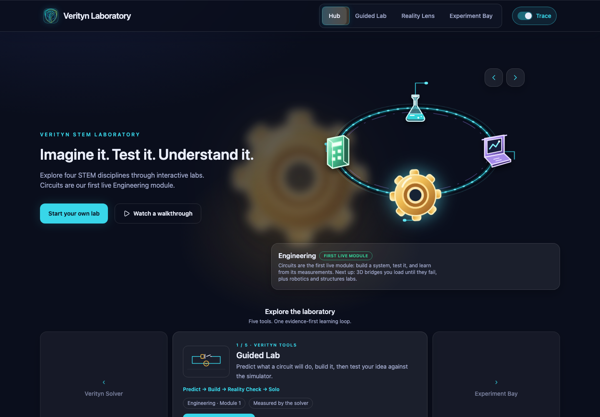
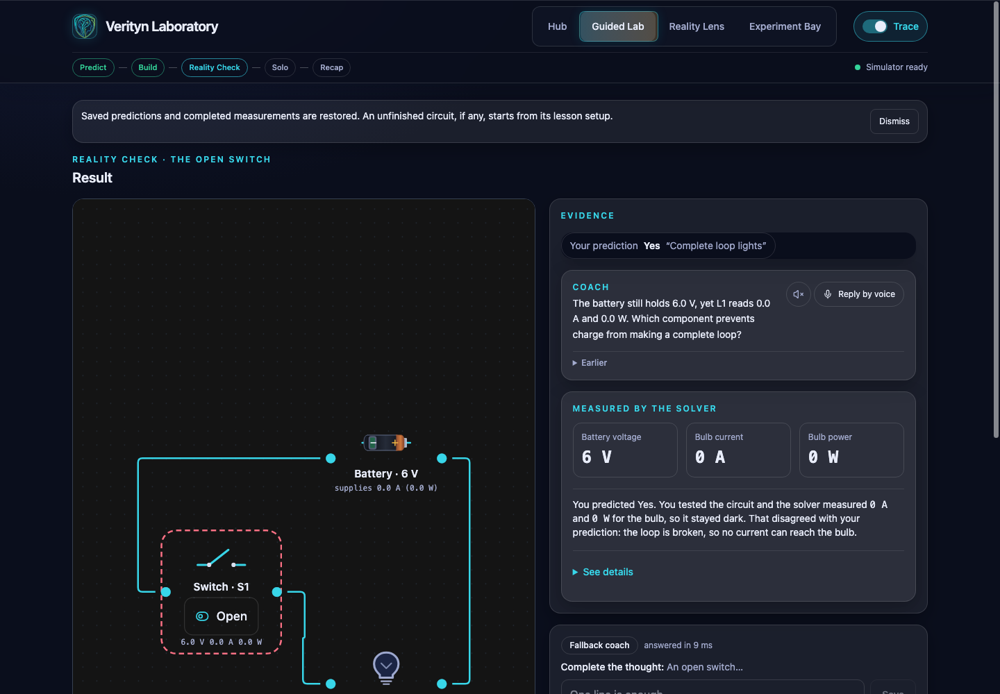
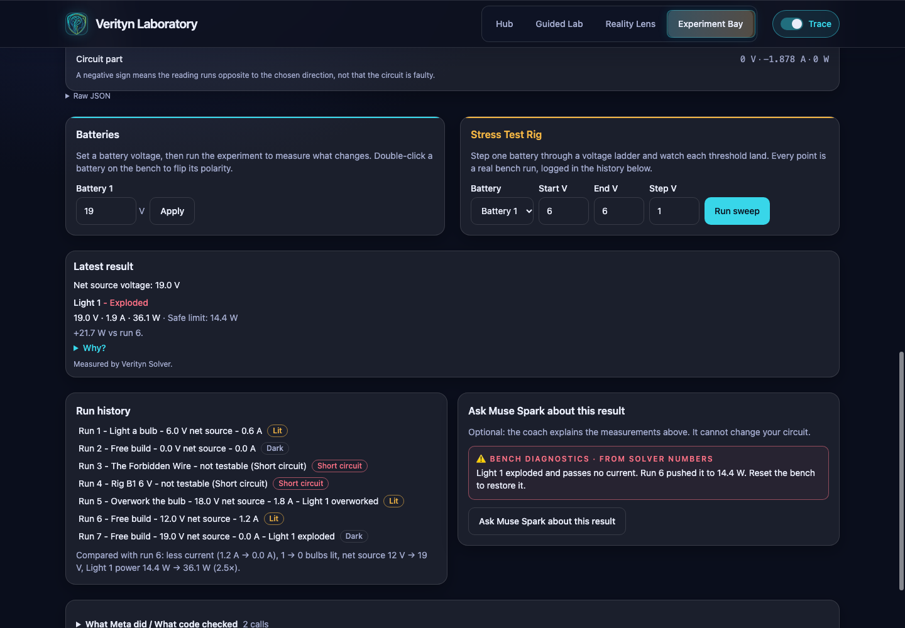
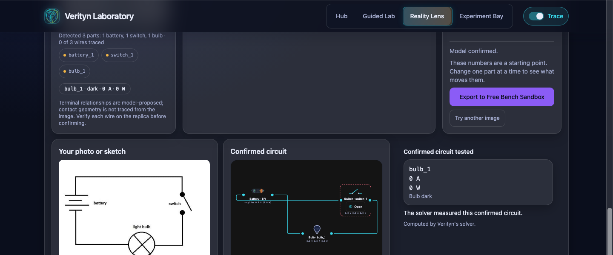
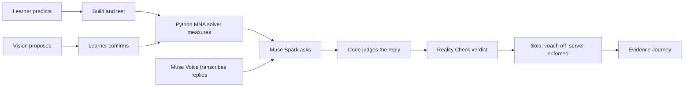

# Verityn  -  A STEM laboratory for thinking first

[](https://verityn-9sqj.vercel.app)
[](LICENSE)


> AI should not make students regress. Verityn has them predict first,
> tests the idea against a simulator, and then takes the coach away.

Built from my own second year of computer science, when I realised
I could not recall my course material ahead of internship interviews.

**Live app:** https://verityn-9sqj.vercel.app

[](https://youtu.be/MRwITo-nEOs)

*Watch: the 3-minute hackathon demo (https://youtu.be/MRwITo-nEOs)*

| Hub: four disciplines, circuits live first | Guided Lab: prediction vs measured truth |
|---|---|
|  |  |

| Experiment Bay: sweep it until it pops | Reality Lens: sketch in, measured circuit out |
|---|---|
|  |  |



Built for the Meta Global AI Developer Hackathon (Indie track,
Build for Your World problem statement), Oct 26 - Nov 4, 2026.
Every commit is in-event; no pre-existing product or codebase.
Solo entrant: Nomathemba Ncube.

## Contents

- [60-second tour](#60-second-tour)
- [Why Verityn](#why-verityn)
- [Features](#features)
- [Smart details](#smart-details)
- [Deliberately out of scope](#deliberately-out-of-scope)
- [Prerequisites](#prerequisites)
- [Setup](#setup)
- [Coach providers](#coach-providers)
- [Launch](#launch)
- [Checks](#checks)
- [Deploy](#deploy)
- [Built with Meta](#built-with-meta)
- [Notes](#notes)
- [Contributing](#contributing)
- [Troubleshooting](#troubleshooting)

Verityn is an evidence-first learning platform for **Science, Technology,
Engineering, and Mathematics**. Its purpose is broader than any one subject:
learners make a prediction, build or interpret a model, test it against
evidence, and explain what they observe.

**Engineering circuits are the first live module**, not the definition of the
platform. The guided circuit lab demonstrates Verityn's learning loop today;
Science, Technology, and Mathematics are future learning pathways, clearly
labelled as such in the interface.

The system keeps reasoning and measurement distinct: a deterministic
modified-nodal-analysis solver establishes circuit ground truth, while Muse
Spark guides Socratic reasoning. It is not a chatbot tutor: there is no
open chat, predictions are constrained, verdicts are derived server-side, the
model never touches physics, and Solo removes AI assistance entirely. Model
outputs are proposals: every Spark reply is checked against the solver's
numbers before the learner sees it, and vision proposals wait for the
learner's confirm. See `docs/` for the architecture, UI spec, product plan,
and test plan.

## 60-second tour

On the [live app](https://verityn-9sqj.vercel.app), no key needed:

1. (0:00) Spin the Hub turntable, then start the Guided Lab.
2. (0:10) Predict No with the reason `The circuit has a gap.`
3. (0:20) Connect the loose terminals, test: 0.6 A, 3.6 W, bulb lit.
4. (0:30) Reality Check: predict Yes, test with the switch open:
   0 A, 0 W, prediction did not match.
5. (0:40) Reply `I would close the switch to complete the loop.`
   Solo unlocks.
6. (0:50) Build the second-bulb Solo circuit with the coach off,
   or detonate the Time Bomb in the Experiment Bay.

## Why Verityn

Answers are everywhere; understanding is not. Verityn brings back
creativity and curiosity to science class: the Guided Lab makes
learners think first and test against evidence, and the Experiment Bay
gives them a bench for joyful messing about - wire anything, blow
bulbs safely, watch what the simulator measures, then ask why. Wrong
answers are data, not verdicts, and every Spark reply is checked
against the solver's numbers before the learner sees it.

## Features

- Guided lab: Predict → Build → Reality Check → Solo → Finale.
  The learner commits to a Yes / No / Not sure prediction with a
  one-line Why, repairs the open-gap circuit (0.6 A / 3.6 W lit),
  meets the open-switch contradiction (0.0 A dark), climbs the
  Question → Pointer → Demonstration coach ladder, and tries a fresh
  second-bulb circuit without the coach.
- Socratic coach ladder: one Question grounded in the measured
  numbers, a Pointer citing the 0.0 A open-switch discrepancy, and a
  Demonstration confirmation. Served
  by Muse Spark when a key is configured, otherwise by the
  labeled deterministic fallback. Eligibility is derived
  server-side; Solo makes zero coach calls, enforced by the
  backend as well as the UI.
- Validated AI demonstrations: the coach may propose closing S1
  from a closed action vocabulary; the app validates, previews,
  applies, re-solves, and offers Undo. Invalid actions never
  mutate state.
- Reality Lens: drop, paste, or upload a schematic or photo (or use a
  sample); Muse Spark vision proposes components, wire traces,
  connections, polarity, and provenance; the learner reviews
  the original beside the editable replica in Compare mode and must confirm
  before the solver runs. `needs_review` and `unsupported`
  diagrams are refused honestly  -  nothing is guessed. Sample diagrams expose
  tappable battery/bulb regions with saved SAM 3.1 provenance; taps select, never
  infer. A confirmed circuit can move to the Experiment Bay for free-form testing.
- Experiment bench: free-form canvas with five starter presets,
  explicit runs, session-local history with current-vs-previous
  comparison, an optional solver-first explanation, a Stress
  Test Rig that sweeps one battery through a voltage ladder and
  tables each threshold, eight session missions in a slide-out
  Mission Log, plain-words rejection guidance with history
  pills and per-run detail, and cinema sweeps (analog gauge,
  replayable points, bench lock, stop notes, no zombie locks,
  latch survives voltage edits).
- Overwork physics (simplified classroom model): rated bulbs
  (12 V / 14.4 W defaults), assessed intact/overworked/exploded
  conditions, per-battery voltage controls, and a session
  explosion latch  -  12 V stays intact, 18 V measures 1.8 A /
  32.4 W overworked, past 18 V explodes at 0.0 A on the run
  itself, reset restores intact.
- Presenter mode: `Play the guided demo` plays the whole
  journey through the real UI in about 40 seconds (pause,
  resume, skip, exit, replay, manual takeover).
- STEM homepage: a selectable four-discipline orbital map with
  Engineering circuits marked as the first live module, plus an
  interactive five-station turntable (Guided Lab, Experiment Bay,
  Reality Lens, Muse Spark, Verityn Solver). The existing
  side-arrow, keyboard, screen-reader, reduced-motion, and
  no-auto-rotation interactions are preserved.
- Voice (optional, never required): tap-to-talk coach replies and a
  microphone in every Why box and the Finale reflection. Muse Voice Transcribe turns each
  recording into editable text; a clear spoken answer pre-selects the
  matching choice but never submits. Spoken coach playback is browser
  speech synthesis, defaults off, and uses a ranked English browser voice
  with short sentence pauses (Muse Voice Transcribe is not text-to-speech).
  Voice capture stops after 1.5 seconds of silence; stage timings are shown
  in Coach Dock for the current session.
  Typing and manual lab controls remain available.
- Deterministic MNA solver (`src/verityn/solver.py`): battery,
  resistor, bulb (fixed 10 Ω), switch, and wire circuits;
  rejected circuits return an error code plus offender ids,
  never invented numbers. The evaluator (`evaluator.py`) judges
  `lit` / `compare_brightness` claims as CONSISTENT,
  CONTRADICTED, or UNASSESSABLE with model-derived evidence.
- Flask API: `POST /api/simulate`, `POST /api/evaluate`,
  `POST /api/coach/predict`, `POST /api/coach/ask`,
  `POST /api/coach/conversation`, `POST /api/voice/transcribe`,
  `POST /api/coach/explain`, `POST /api/vision/propose`.
  Judged outcomes return HTTP 200; malformed requests return
  HTTP 400 `MALFORMED_REQUEST`; errors are JSON, never
  tracebacks; keys stay server-side in an untracked `.env`.
- Test suites (mocked model HTTP, zero live calls in tests):
  backend and frontend suites, lint, production build, plus
  `scripts/smoke_live.py` and `scripts/smoke_browser.mjs` end-to-end checks.
- Pinned backend dependencies (`backend/requirements.txt`).

## Smart details

<details>
<summary><strong>25 verified behaviors</strong> - click to expand the full table</summary>

| Behavior | Where to see it | Test or trace |
|---|---|---|
| Spoken correction of a choice | Predict, Reality Check, and Solo | [Spoken prediction tests](./frontend/src/voice/spokenPrediction.test.ts) |
| Coach replies use the learner's own words | Coach Dock follow-up | [Meta coach tests](./backend/tests/test_meta_coach.py) |
| Solver-grounded explanations with a number guard | Experiment Bay and Finale | [Explanation tests](./backend/tests/test_explain.py) |
| Leak guard and one validation retry | R1 coach question | [Retry trace test](./backend/tests/test_trace.py) |
| Stale-state protection for cancelled or superseded requests | Reality Lens and circuit runs | [API cancellation tests](./frontend/src/api/client.test.ts) |
| Honest `needs_review` and `unsupported` Reality Lens proposals | Reality Lens review | [Vision validation tests](./backend/tests/test_vision.py) |
| Server-enforced Solo with zero coach calls | Solo second-bulb challenge | [Transfer tests](./backend/tests/test_transfer.py) |
| Typed errors with actionable next steps | API responses and learner notices | [Error-safety tests](./backend/tests/test_error_safety.py) |
| Prediction lock-in with a short undo window | Voice replies in every stage | [Spoken prediction tests](./frontend/src/voice/spokenPrediction.test.ts) |
| Ranked English browser voice with measured pacing | Coach Dock playback | [Coach voice tests](./frontend/src/voice/coachVoice.test.ts) |
| Current flow and bulb glow follow solver measurements | Circuit test result | [Visual mapping tests](./frontend/src/canvas/visuals.test.ts) |
| Solver readouts count up to the measured value | Guided result card and circuit readouts | [Readout tests](./frontend/src/components/ReadoutValue.test.ts) |
| Finale circuits reveal in order with reduced motion respected | Finale timeline | [Finale motion tests](./frontend/src/journey/finaleMotion.test.ts) |
| Hub health checks retry with visible startup progress | Hub on first load | [Health status tests](./frontend/src/components/HealthStatus.test.tsx) |
| Voice capture stops after silence and records per-stage timings | Coach Dock voice timing details | [Voice timing tests](./frontend/src/voice/voiceTimings.test.ts) |
| Finale handoff reuses the saved circuit in Experiment Bay | Journey Finale experiment action | [Finale tests](./frontend/src/components/JourneyFinale.test.tsx) |
| Lens diagrams upload by drop, paste, picker, or camera | Reality Lens drop zone | [Upload tests](./frontend/src/vision/upload.test.ts) |
| Traced wires overlay the uploaded photo | Lens review original | [Review tests](./frontend/src/vision/review.test.ts) |
| Confirmed Lens circuit opens in Experiment Bay | Lens review handoff action | [Experiment Bay seed tests](./frontend/src/experiment/ExperimentPage.test.tsx) |
| Guided verdicts compare predictions with solver readings, kindly | Reality Check, Solo, and Journey | [Verdict line tests](./frontend/src/components/PredictionVerdictLine.test.tsx) |
| Batteries report supplied current and power, never negative labels | Guided canvases and Journey snapshots | [Canvas node tests](./frontend/src/components/canvas/CircuitNode.test.tsx) |
| Voice transcripts are cleaned for display; raw text stays in Trace | Why boxes, Journey, and Trace drawer | [Transcript tests](./frontend/src/voice/displayTranscript.test.ts) |
| Journey progress highlights Recap on the recap page | Guided Lab header | [Stage tests](./frontend/src/journey/stages.test.ts) |
| Saved Reality Lens segments are tappable with SAM 3.1 provenance | Sample diagrams | [Sample segment tests](./frontend/src/lens/sampleSegments.test.ts) |

</details>

## Deliberately out of scope

- No login, accounts, persistence, or analytics; history is
  session-local.
- No open chat: predictions are constrained choices and the
  model never touches physics.
- No mastery/dependency scores: the finale shows observed
  session evidence only.
- No resistor canvas node (the solver accepts resistors but
  the palette does not place them).
- Full Science, Technology, and Mathematics subject modules are
  future pathways, not lessons already shipped. Engineering
  circuits are the first live module; broader engineering systems
  remain future work.
- External open-weight hosting (Baseten/Modal) deferred.

## Prerequisites

- Node.js 20.19+ or 22.12+ (required by Vite).
- Python 3.10+.

## Setup

Backend (from the repo root):

```sh
python3 -m venv .venv
source .venv/bin/activate
pip install -r backend/requirements.txt
```

Frontend:

```sh
cd frontend
npm install
```

## Coach providers

Coaching defaults to fixed fake templates (no network, no key needed).
To use Muse Spark with template fallback, export `MODEL_API_KEY` in the
backend's shell (e.g. `export MODEL_API_KEY=...`), then start the
backend normally; recorded predictions and Why text are sent to the
Meta Model API only in that mode. The backend auto-loads an untracked
root `.env` (never commit it); an exported `MODEL_API_KEY` wins over
the file. The same key also enables Meta vision proposals. `VERITYN_COACH_FAIL=1` forces the
provider-failure path for local testing. The automated suites mock all
model HTTP and never spend credits.

## Launch

Terminal 1  -  backend (from the repo root):

```sh
source .venv/bin/activate
python backend/app.py
```

Backend listens on http://127.0.0.1:5000. The frontend dev proxy
points at `VERITYN_API` (default http://127.0.0.1:5001), so if the
ports differ, pair them (see `.env.example`).

Terminal 2  -  frontend:

```sh
cd frontend
npm run dev
```

Open the printed local URL (usually http://localhost:5173) in a browser.
The status badge reads “Simulator ready” when both servers run; stop the
backend and it shows the error state with a retry button.

## Checks

Last full run: 647 backend passed, 627 frontend passed, lint clean,
`tsc -b` and production build clean, browser smoke passed
(docs-only changes since).

```sh
cd frontend && npm test         # frontend unit tests (vitest)
cd frontend && npm run build   # typecheck + production build
python -m pytest backend/tests -q   # backend tests (venv active)
python scripts/smoke_live.py   # live judging-path smoke check (venv active)

# With the backend and a frontend dev server running:
BASE=http://localhost:5174 node scripts/smoke_browser.mjs   # full browser journey
```

## Deploy

Vercel, same origin: the static frontend plus one Python serverless
function (`api/index.py`, the Flask app). `vercel.json` builds
`frontend/dist` and rewrites `/api/*` to the function, so the
deployed app needs no CORS config.

1. Import the repo (root directory = repo root).
2. Set `MODEL_API_KEY` in Vercel env. Without it the deploy keeps
   the deterministic fakes. Never copy `.env` to a server.
3. Deploy. Coach sessions are per-instance memory, so rung order
   can reset if traffic spans fresh instances; single-user runs
   are unaffected. Full checklist: `docs/SUBMISSION.md`.

## Built with Meta

| Tool | Used for | Evidence |
|---|---|---|
| Muse Spark | R1 coach questions, solver-grounded explanation drafts, and Reality Lens vision proposals | [Trace and validation notes](./docs/INTELLIGENCE_LOG.md) |
| Muse Voice Transcribe | Speech-to-text for Predict, Reality Check, Solo, and the Finale reflection | [Voice API notes](./docs/ARCHITECTURE.md) |
| Segment Anything Model 3.1 (SAM 3.1) | Sample only; taps select saved segments, no live inference | [Sample probe results](./docs/sam-spike-results.json) |

Pointer and Demonstration are deterministic by design, not model calls. SAM 3.1 is
sample-only; no live SAM 3.1 inference is used.
Browser speech playback is browser-native, not Meta text-to-speech.
Provider labels and trace rows
identify the provider that actually served each response.

## Notes

- API keys stay server-side in an untracked `.env` file, never in the
  frontend or Git history.
- Vite proxies `/api/*` to the Flask backend during development.
- Lucide icons use current canonical names (`CircleCheckBig`, `CircleX`,
  `LoaderCircle`); the spec doc predates the rename.
- The UI font stack lists Space Grotesk / JetBrains Mono first with system
  fallbacks; the fontsource packages arrive with the first real screens.

## Contributing

PRs welcome. Set up with `## Setup`, then run the `## Checks`
before pushing: frontend tests, production build, backend tests.
The suites mock all model HTTP, so contributing costs no API
credits. Keep solver physics and coach wording in their separate
layers: the model proposes, code decides.

## Troubleshooting

If `npm` fails with `EPERM` on `~/.npm` (root-owned cache from an old npm
bug), fix ownership once with `sudo chown -R $(id -u):$(id -g) ~/.npm`,
or run npm with a disposable cache: `npm_config_cache=/tmp/npm-cache npm …`.

If Run Simulation reports HTTP 404, the process on port 5000 is a stale
backend that predates the API routes: stop it (Ctrl-C in its terminal, or
find it with `lsof -iTCP:5000 -sTCP:LISTEN` and `kill` it), then start the
backend fresh from the repo root with `source .venv/bin/activate` and
`python backend/app.py`. A tell-tale sign is "Address already in use" when
starting the backend (the stale process still holds the port), or an HTML
404 page  -  the current backend answers unknown API routes with JSON.
